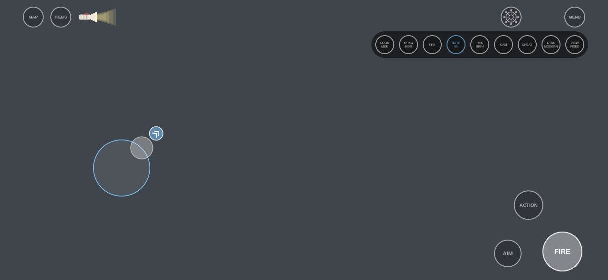

# Silent Hill 3 for iPhone: build your own

**Silent Hill 3 on iPhone**, made from your own PC copy of the game. It runs natively (no emulator), with touch
controls, 60 fps and controller support. GitHub builds it for you, for free, and you can do it all from your phone.

The touch controls with the settings tray open, drawn by the port's own code on a plain background (not a
picture of the game). In the game they sit over the picture. Screenshots from an iPhone are coming soon.

**[Make it now](#make-it)** · [What you need](#what-you-need) · [Installing](#installing) · [Playing](#playing)

## Cool features

- **Native, not emulated:** the PC game's own code turned into iPhone code, so it runs smoothly.
- **60 frames a second**, held steady with SilentHill3.FusionFix's frame pacing fix. Or 30, for a cooler phone.
- **Full-screen widescreen** that fills your phone's screen.
- **Touch controls made for the game:** a stick appears under your left thumb (push past its ring to run), drag
  to look, and big FIRE, AIM and ACTION buttons. A quick tap does ACTION.
- **Modern or classic controls:** the stick points where Heather goes, or the original tank controls.
- **Free camera:** swap the fixed camera angles for a camera over Heather's shoulder that you turn with your
  thumb.
- **Photo camera:** take photos, bursts and selfies (the game freezes and the camera swings round to face
  Heather), or freeze a moment and walk the camera round it. Photos go to your Photos app.
- **A cheat:** hold the Halo of the Sun button and Heather can't die.
- **Controllers:** Xbox, PlayStation and MFi controllers work; the touch buttons hide while one is connected.

## Thanks

This only exists thanks to other people's hard work:

- **[cutarev](https://github.com/cutarev)**, who made [sh3-nx](https://github.com/cutarev/sh3-nx) (and
  [sh2-nx](https://github.com/cutarev/sh2-nx) before it): Silent Hill 3's PC code turned into native code. The
  iPhone version is built on it. Thank you!
- **[Ligux01](https://github.com/Ligux01)**, for fixing the broken car windows after the Missionary fight.
- **ThirteenAG**, for the [widescreen fix](https://github.com/ThirteenAG/WidescreenFixesPack) and
  SilentHill3.FusionFix: its frame pacing fix and modern camera are where this port's steady 60 fps and free
  camera come from.
- **[sp00nznet](https://github.com/sp00nznet/xboxrecomp)** for the code translator, and the SDL and
  [ANGLE](https://chromium.googlesource.com/angle/angle) projects.
- **Konami and Team Silent**, for making Silent Hill 3.

## Sorry about the bugs

This is an unofficial fan project and the iPhone version is very new, so please expect bugs. It's little tested
on an iPhone and nobody has played it all the way through yet: it may crash or draw something wrong in places
we haven't reached. Things we know about:

- The game's movies (FMVs) are skipped for now.
- After the cutscene in the Office Building bathroom the screen can stay black: press ACTION to carry on.
- The Konami logos and the credits are stretched on a wide screen.
- The photo camera's frozen views can have gaps where the game never drew anything.

There's no multiplayer to worry about (it's a single-player game). Sorry about the rough edges. If something goes
wrong, please [open an issue](https://github.com/sithewok13-dev/silent-hill-3-builder/issues) and attach
`sh3.log` (and `sh3-crash.log`, if there is one).

## What you need

- A free [GitHub account](https://github.com/signup).
- **Silent Hill 3 for PC** as **one file**: the game's ISO, or the installed game's folder (the one with
  `sh3.exe`) zipped (.iso, .zip, .7z or .rar).
- A way to install apps from outside the App Store (see [Installing](#installing)).
- About **8 GB** free on your iPhone.

## Make it

1. **Share your game.** Put the file in Google Drive (or Dropbox). In Drive: tap **⋮ > Share**, set
   **General access** to **Anyone with the link**, then **Copy link**.
2. **Make your copy of this page.** Tap the green **Use this template** button at the top, then **Create a new
   repository**. Any name, choose **Private** (your game goes in it), **Create repository**.
   *Don't see the button? In Safari, tap **aA > Request Desktop Website**.*
3. **Build.** In your copy: **Actions** > **Build Silent Hill 3 for iPhone** > **Run workflow**. Paste your link
   in the first box and tap the green **Run workflow**. It takes about 20–30 minutes; you can close the page.
   A green tick means done. A red cross: tap it to see what went wrong, in plain words.
4. **Get the app and game files.** On your copy's front page, scroll to **Releases**:
   - **Silent Hill 3 app**: tap **SH3.ipa** and install it (see below).
   - **Game files**: download every **SH3-game-N.zip**, then in the **Files** app move them from *Downloads* to
     **On My iPhone > Silent Hill 3**.
5. **Play.** Open the app. The first time, it unpacks the zips (a few minutes) and deletes them.

## Installing

| | Cost | Computer? |
|---|---|---|
| **[SideStore](https://sidestore.io)** | Free (your Apple ID) | Once, to set it up. After that, open SideStore and tap **Refresh All** at least once a week: if you go past 7 days, SideStore and your apps expire and you'll need the computer again. |
| **[Signulous](https://www.signulous.com)** or **[UDID Registrations](https://www.udidregistrations.com)** | About $20 a year | No. Upload the IPA to their site and install from there. |
| **[Feather](https://github.com/khcrysalis/Feather)** | Your own [Apple Developer account](https://developer.apple.com/programs/) ($99 a year), or a signing service's certificate | No |

More options and details

- **[AltStore](https://altstore.io)** and **Sideloadly** are free too, but need a computer every week or every
  install.
- **[AppDB PLUS](https://appdb.to)** (about €12 a year) works like Feather: it needs a developer account or
  certificate.
- UDID Registrations also gives you certificate files you can use in Feather.
- Signing services are third parties, not part of this project. Apple sometimes revokes their certificates; the
  app then won't open until the service re-signs it.
- With a free Apple ID, iOS gives apps less memory space than the game normally reserves, so it runs with a
  smaller amount (`guest arena` in its log). A paid developer account removes that limit.

## Updating

In your copy: **Actions** > **Build Silent Hill 3 for iPhone** > **Run workflow**, with the link box **empty**.
Only the app is rebuilt (about 15 minutes). Install the new SH3.ipa the same way; your game files and saves stay.

## Playing

- **Move:** a stick appears under your left thumb. Push past its ring to run.
- **Look:** drag on the right side.
- **FIRE**, **AIM**, **ACTION** at the bottom right (a quick tap on the right is ACTION too); **MAP**, **ITEMS**
  and the flashlight at the top left.
- **MENU** (top right): tap to pause or skip; hold for settings (look speed, opacity, 60/30 fps, resolution,
  photo camera, cheat, classic controls, free camera).
- Controllers (Xbox, PlayStation, MFi) work; the touch buttons hide while one is connected.
- Phone warm? Set **RATE** to 30 or **RES** to BAL in the settings.

## Good to know

- **Keep your copy private** and don't share the app or game files: they're made from your game.
- A free GitHub account's 2,000 monthly build minutes cover many builds; one uses under a tenth.
- Saves are in *Files > On My iPhone > Silent Hill 3 > savedata*.
- Problems? The app writes `sh3.log` (and `sh3-crash.log` after a crash) in the same Files folder.

The iPhone version, its touch controls and this template are by
[sithewok13-dev](https://github.com/sithewok13-dev/sh3-nx/tree/ios).

Silent Hill is a trademark of Konami. Not affiliated with or endorsed by Konami. This project contains nothing of
the game: you build from your own copy.
